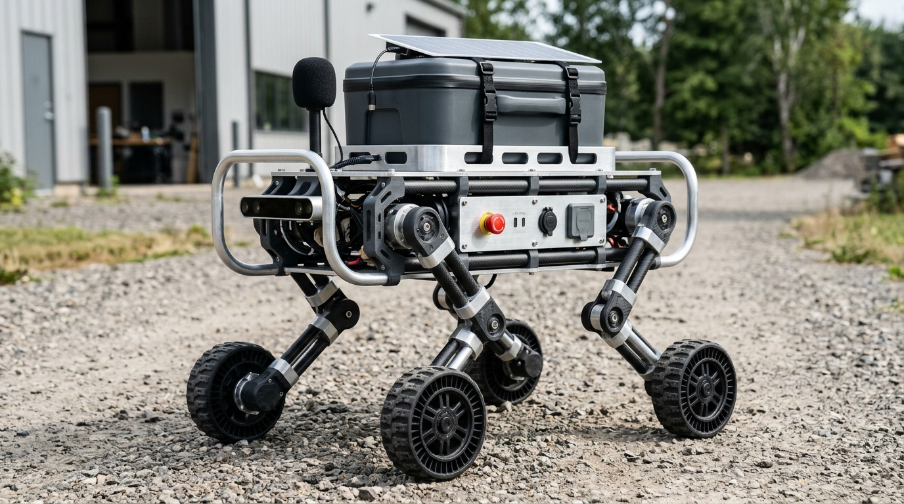
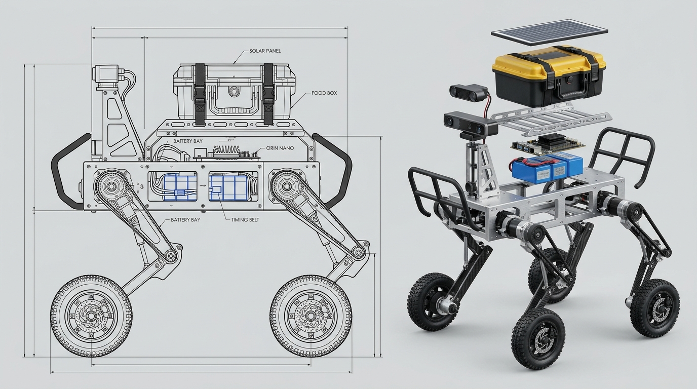

# Wheel-Legged Outdoor Logistics Quadruped — Master Plan (v4)

> [!IMPORTANT]
> This v4 plan reflects the finalized `/grill-me` alignment: dedicated project folders under [`robot/`](./README.md), a locked open-frame industrial concept design with symmetric `< >` X-configuration legs and lid-mounted solar, and a dedicated **Stage 2 Edge AI platform** built around **NVIDIA Jetson Orin Nano Super (8 GB, 67 TOPS, $249)** + **Luxonis OAK-D Lite ($149)** while preserving **Project 1 (RPi 5)** and targeting **Stage 3 (80 kg payload, Jetson AGX Thor onboard)**.

## 1. Visual & Industrial Concept Design





- **Look & Build Aesthetic:** Open-frame industrial utility look—CNC-machined `6061-T6` aluminum spine/plates, carbon fiber tubes, annealed `PA-CF` (`PA12-CF` / `PAHT-CF`) housings, compliant airless `TPU 95A` wheel treads, bolted top cargo rack, and **front/rear tubular roll bars**.
- **Leg Geometry (`Symmetric < > X-Configuration`):** Front knees bend **backward** ($q_3 < 0$) and rear knees bend **forward** ($q_3 > 0$) so knee knuckles clear vertical stair/curb risers during climb and balance fore/aft payload CoG shifts.
- **Cargo & Lid Solar:** Top bolted rack carries a removable external insulated food box (no active cooling) or field appliance mount; a **quick-disconnect semi-flexible solar panel mounts directly on the insulated box lid** (plus optional fold-out side wings) so it charges while loaded outdoors.
- **Full Spec:** See [`shared/concept_design.md`](./shared/concept_design.md).

---

## 2. Reorganized 3-Project Workspace Architecture

All documentation lives in dedicated folders per hardware scale:

```text
robot/
├── README.md
├── MASTER_PLAN.md
├── shared/
│   ├── concept_design.md
│   └── assets/ (robot_concept_hero.jpg, robot_concept_diagram.jpg)
├── 01_quarter_scale_rpi5/      <-- Stage 1 (~$1.88k–$2.15k hardware baseline)
├── 02_half_scale_jetson_oakd/  <-- Stage 2 (~$3.5k–$4.8k)
└── 03_full_scale_thor/         <-- Stage 3 (~$11k–$18k DIY)
```

| Feature | Project 1 (`01_quarter_scale_rpi5`) | Project 2 (`02_half_scale_jetson_oakd`) | Project 3 (`03_full_scale_thor`) |
| :--- | :--- | :--- | :--- |
| **Scale / Payload** | 1/4 Scale (`~3.8 kg` empty + `1 kg` payload) | 1/2 Scale (`~20 kg` empty + `10 kg` payload) | 1/1 Scale (`~85–95 kg` empty + **`80 kg` payload**) |
| **Step / Curb Target** | `6 cm` | `12–15 cm` | **`≥ 25–30 cm`** |
| **Leg Actuators (12 DOF)** | 12× Feetech STS3250 servos (`2:1` GT2 belt on knees) | **Hybrid:** 8× bought 8108-class planetary BLDC hips + 4× DIY CNC Al/`PA-CF` belt or cycloidal knees (`45–60 N·m`) | 12× frameless BLDC + metal cycloidal/harmonic drives (`120–180+ N·m` peak) |
| **Wheel Drives (4 DOF)** | 4× 25GA-370 brushed geared + encoders | 4× 6010-class hub/geared BLDC + FOC ESCs | 4× 500–1000 W hub BLDCs + rear mechanical park brakes |
| **Real-Time MCU** | Teensy 4.1 (`200 Hz` dual UART @ 1 Mbps) | Teensy 4.1 (`500 Hz` dual CAN-FD) | Teensy 4.1 / STM32H7 (`1 kHz` dual CAN-FD / EtherCAT) |
| **Onboard AI Compute** | **Raspberry Pi 5 (8 GB)** | **NVIDIA Jetson Orin Nano Super (8 GB, 67 TOPS, `$249`)** | **NVIDIA Jetson AGX Thor** *(already owned)* |
| **Primary Vision Sensor** | Pi Camera Module 3 Wide (`IMX708`) | **Luxonis OAK-D Lite Fixed-Focus (`$149`, USB-C)** | Stereo RGB-D + optional 3D LiDAR |
| **Edge AI Capabilities** | Offline Vosk EN/ES voice, Piper TTS, basic tag/color check | On-VPU YOLOv8n obstacle/person safety stop, TensorRT RL walking/climbing policy (trained offboard on **Thor**), GPU `faster-whisper` + 1B–1.5B local LLM JSON parser, optional voice-toggled "Follow Me" | Full terrain-aware RL locomotion, dynamic payload adaptation, SLAM obstacle avoidance, large bilingual local LLM |
| **Battery & Runtime** | 3S4P Molicel P42A (`186.5 Wh`) | 48 V (`13S` Li-ion, `~960–1,000 Wh`, `~4.5 hr` cruise) | 48 V (`16S` LiFePO4, **`5.12 kWh`**, **`4+ hr`** duty) |
| **Appliances & Solar** | USB-C PD (`65–100 W`) + `12 V` spark igniter + `20 W` lid solar demo | `300 W` pure-sine inverter demo + `100 W` USB-C PD + `12 V` igniter + `40–50 W` lid solar | **`1,000–1,200 W` Victron pure-sine + GFCI (blender)** + `100 W` PD + `12 V` igniter + `100–200 W` solar |
| **Est. DIY Cost** | `~$1,880–$2,150` *(12-servo baseline)* | `~$3,500–$4,800` *(baseline `~$4,273`)* | `~$11,000–$18,000` |

---

## 3. 10-Day Gated Execution Schedule (Project 1 Kickoff)

See [`01_quarter_scale_rpi5/00_10day_gated_schedule.md`](./01_quarter_scale_rpi5/00_10day_gated_schedule.md) for the 5 two-day Stage Gates (`Nov 15 – Nov 24, 2026`), decision checklists, and mandatory approval hold points.
