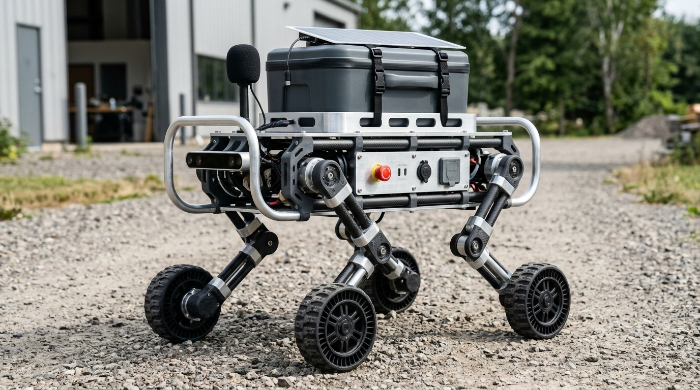
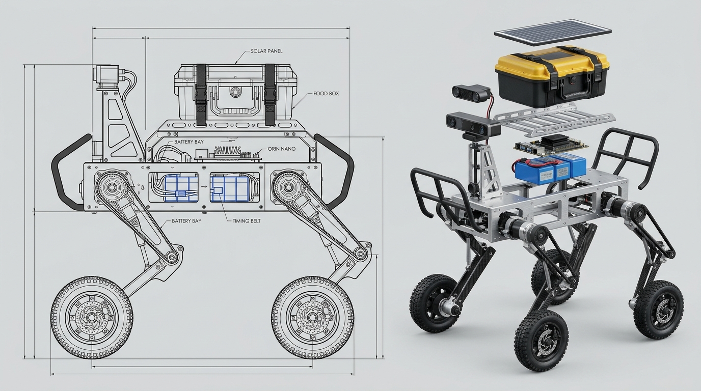

# Shared Industrial & Mechanical Concept Design





## 1. Visual & Industrial Identity

Across all three scales, the robot uses an **open-frame industrial utility aesthetic** rather than a closed cosmetic shell. Exposed CNC-machined structural plates, carbon-fiber tubes, and 3D-printed carbon-fiber-reinforced nylon (`PA-CF`) joints prioritize field serviceability, heat dissipation, weight reduction, and straightforward DIY fabrication in **Autodesk Fusion 360** and **Blender**.

| Element | Material / Finish | Purpose |
| :--- | :--- | :--- |
| **Upper & Lower Chassis Plates** | CNC-machined `6061-T6` aluminum (anodized matte black or raw brushed) | Rigid mounting backbone for hip blocks, battery rails, compute stack, and cargo rack |
| **Longitudinal Spine & Crossmembers** | Carbon fiber square/round tubes clamped in CNC/PA-CF blocks | High bending stiffness with low structural mass |
| **Roll Bars (Front & Rear)** | Bent `6061-T6` or `4130` chromoly tubing bolted to spine | Protects stereo vision mast, microphone array, antennas, and top cargo during rollovers or stair impacts |
| **Hip Housings, Thigh Links, Brackets** | Annealed `PA-CF` (`PA12-CF` or `PAHT-CF`) + CNC aluminum bearing inserts | Complex geometry printed in-house; metal inserts carry bearing seats and clamp loads |
| **Shin Tubes & Guards** | Carbon fiber tube + `PA-CF` clevis / wheel fork | Low distal inertia for rapid leg swing and step clearance |
| **Wheel Treads** | Compliant airless lattice or grooved `TPU 95A` tire over `PA-CF` hub | Shock absorption on rock/gravel plus wet traction and field printability |
| **Cargo System** | Bolted aluminum extrusion / plate cargo rack + tie-down slots | Accepts external insulated food container (no active cooling) or kitchen appliance cradle |
| **Solar Array** | Quick-disconnect semi-flexible monocrystalline panel on container lid (+ optional fold-out side wings) | Maintains charge while hauling cargo outdoors without blocking battery swaps |
| **Side Utility & Safety Panel** | Recessed CNC aluminum fascia on left/right flank | Mushroom E-stop (`NC`), XT60/XT90 charge port, USB-C PD ports, 12 V DC spark/accessory jack, GFCI AC outlet (Stage 2 demo / Stage 3 full 1 kW) |

---

## 2. Leg Kinematics: Symmetric X-Configuration (`< >`)

All three scales use a **Symmetric X-Configuration (`< >`)**:

- **Front legs (FL, FR):** Knees bend **backward** ($q_3 < 0$, pointing toward the center of the chassis).
- **Rear legs (RL, RR):** Knees bend **forward** ($q_3 > 0$, pointing toward the center of the chassis).

```text
   Front                              Rear
    [O]----\                      /----[O]     Hip pitch (q2)
            \                    /
             \  <-- Front Knee  /  <-- Rear Knee
              >     (q3 < 0)   <       (q3 > 0)
             /                  \
            /                    \
          (O)                    (O)           Powered wheel foot
```

### Why `< >` X-Configuration Beats All-Backward (`< <`) for Stair & Curb Logistics

1. **Stair Riser Clearance:** Forward-facing front shins and backward-facing rear shins keep knee knuckles pulled inward away from vertical step risers during both ascent and descent.
2. **Symmetric CoG Envelope:** Fore/aft payload shifts (insulated food box, full blender pitcher) produce balanced pitching torque margins in both forward and reverse travel.
3. **Wider Stance Stability Under Braking:** Bracing outward reduces pitch-over tendency when stopping on loose gravel or slopes.

---

## 3. Compute, Vision & HRI Stack Placement

- **Front Roll-Bar Mast:** Wide-angle RGB camera (Project 1: Pi Camera Module 3 Wide) or stereo AI depth camera (Project 2/3: Luxonis OAK-D Lite / stereo + optional LiDAR) recessed behind the front tubular guard for unobstructed downward terrain visibility (`20°–30°` downward tilt).
- **Rear Isolated Mast (`120 mm` height):** Circular 4-mic array (`ReSpeaker` / DSP mic) decoupled on Shore 40A elastomer bobbins under an open-cell `35 PPI` acoustic wind foam dome to keep fan/actuator noise out of the wake-word pipeline.
- **Internal Thermal & EMI Bay:** Lower deck houses battery pack in a drop-out aluminum tray; upper suspended deck isolates Teensy 4.1 real-time controller, SBC (`RPi 5` or `Jetson Orin Nano Super` / `AGX Thor`), and motor power distribution.
- **Safety Interlock Rule:** Plugging in external AC shore charger or activating the 12 V/AC appliance output triggers the hardware **drive-away lockout**—locomotion motors cannot arm until power cords/ignition leads are stowed, while E-stop cleanly drops motor bus power without corrupting the SBC filesystem.

---

## 4. Three-Stage Scaling Architecture

| Parameter | Project 1 (`01_quarter_scale_rpi5`) | Project 2 (`02_half_scale_jetson_oakd`) | Project 3 (`03_full_scale_thor`) |
| :--- | :--- | :--- | :--- |
| **Scale / Target Role** | 1/4 Scale — Kinematics, voice/RC & wheel-leg validation | 1/2 Scale — Edge AI vision, RL locomotion & hybrid actuators | 1/1 Scale — 80 kg field logistics & 1 kW appliance power |
| **Total Mass (Empty / Payload)** | ~3.8 kg / 1.0 kg (`4.8 kg` loaded) | ~20 kg / 10 kg (`30 kg` loaded) | ~85–95 kg / 80 kg (`~170 kg` loaded) |
| **Step / Curb Climb Target** | `6 cm` | `12–15 cm` | `≥ 25–30 cm` |
| **Leg Actuators (12 DOF)** | 12× Feetech STS3250 (`4.9 N·m` stall; 2:1 GT2 belt on knees) | **Hybrid:** 8× bought 8108-class planetary BLDC hips (`~25–35 N·m`) + 4× DIY CNC Al/PA-CF cycloidal or HD-belt knees (`45–60 N·m`) | 12× frameless BLDC + metal cycloidal/harmonic drives (`120–180+ N·m` peak) |
| **Wheel Drives (4 DOF)** | 4× 25GA-370 brushed geared + quadrature encoders | 4× 6010-class hub/geared BLDC + FOC ESCs | 4× 500–1000 W geared hub BLDCs |
| **Real-Time MCU** | Teensy 4.1 (`200 Hz` UART @ 1 Mbps) | Teensy 4.1 (`500 Hz` dual CAN-FD) | Teensy 4.1 / STM32H7 (`1 kHz` dual CAN-FD / EtherCAT) |
| **Onboard AI / Compute** | Raspberry Pi 5 (8 GB) | **Jetson Orin Nano Super** (8 GB, 67 TOPS, $249) | **Jetson AGX Thor** (already owned) |
| **Vision Sensor** | Pi Camera Module 3 Wide (`IMX708`) | **Luxonis OAK-D Lite** ($149, on-camera VPU depth + YOLO) | Stereo/RGB-D + optional 3D LiDAR |
| **AI Capabilities** | Offline Vosk EN/ES voice + Piper TTS + color/AprilTag checks | On-VPU YOLO safety stop, optional "Follow Me", TensorRT RL walking/climbing policy (trained on Thor), GPU Whisper + small local LLM intent parser | Full terrain-aware RL locomotion, dynamic payload adaptation, obstacle avoidance, bilingual Whisper + local LLM |
| **Battery Pack** | 3S4P Molicel P42A (`186.5 Wh`) | 48 V (`13S` NMC or `16S` LFP, `~800–1,000 Wh`) | 48 V (`16S` LFP, `~4.5–5.1 kWh`, `4+ hr` target) |
| **Appliance & Solar Output** | USB-C PD (`65–100 W`) + 12 V DC igniter + 20 W lid solar demo | 300 W pure-sine AC inverter demo + USB-C PD + 12 V DC igniter + 40–50 W lid solar | **1,000–1,200 W pure-sine AC + GFCI** (blender) + USB-C PD + 12 V DC + 100–200 W solar |
| **Estimated DIY Budget** | ~$1,200–$1,700 USD | ~$3,500–$4,800 USD | ~$11,000–$18,000 USD |
